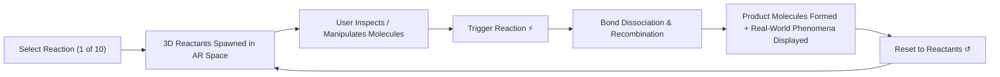

# DIP Touchless STEM — Interactive Chemistry Laboratory & Reactions Specification

> **Real-Time Touchless 3D Molecular Modeling and Interactive Chemical Reactions using a Single RGB Webcam**  
> *Component of the Digital Image Processing (DIP) Graduation Capstone Project*

---

## 1. Executive Summary

The **Chemistry Laboratory** in **DIP Touchless STEM** provides a markerless, touchless Augmented Reality (AR) learning platform. Powered by standard monocular RGB webcam input, MediaPipe hand landmark tracking, and adaptive 1-Euro motion signal filtering, students and educators can construct, manipulate, and simulate 3D molecular structures and **10 representative chemical reactions** in real time.

```
       [ Monocular RGB Camera ]
                  │
                  ▼
   [ ROI Illumination & CLAHE ]
                  │
                  ▼
 [ Hand Landmark Detection (MediaPipe) ]
                  │
                  ▼
    [ Adaptive 1-Euro Filter ]
                  │
                  ▼
[ Touchless Gesture Recognition (Pinch / Dwell / Grip) ]
                  │
                  ▼
 [ 3D Molecular Graph & Reaction Simulation Engine (OpenGL) ]
```

---

## 2. Core Capabilities & Architectural Pillars

### 2.1. 118-Element Periodic Table
- Sourced directly from **PubChem** data specifications (`pubchem-periodic-table.json`).
- Displays complete atomic properties: Atomic Number ($Z$), Standard Element Symbol, Full Name, Atomic Mass, Group Block, and Electronegativity.
- **Dynamic Electron Configuration**: Computes subshells ($s, p, d, f$) and main electron shells ($K, L, M, N, O, P, Q$) dynamically.
- **Animated Bohr Orbitals**: Visualizes concentric electron shells with orbiting electrons proportional to atomic number and energy level.

### 2.2. 72 Curated Curriculum Chemical Compounds
- Categorized into 5 fundamental secondary & high school chemistry groups:
  1. **Oxides** ($\text{CO}_2, \text{CaO}, \text{SO}_2, \text{SO}_3, \text{Fe}_2\text{O}_3, \dots$)
  2. **Acids** ($\text{HCl}, \text{H}_2\text{SO}_4, \text{HNO}_3, \text{H}_3\text{PO}_4, \text{CH}_3\text{COOH}, \dots$)
  3. **Bases** ($\text{NaOH}, \text{Ca(OH)}_2, \text{Ba(OH)}_2, \text{Cu(OH)}_2, \text{Fe(OH)}_3, \dots$)
  4. **Salts** ($\text{NaCl}, \text{CaCO}_3, \text{CuSO}_4, \text{BaSO}_4, \text{CaCl}_2, \text{Na}_2\text{CO}_3, \dots$)
  5. **Organics** ($\text{CH}_4, \text{C}_2\text{H}_4, \text{C}_2\text{H}_2, \text{C}_2\text{H}_5\text{OH}, \text{CH}_3\text{COOC}_2\text{H}_5, \dots$)

### 2.3. Molecular Graph & Connectivity Engine
- **Valence-Bounded Covalent Graph**: Enforces neutral valence rules (e.g., $H=1, O=2, N=3, C=4$, expanded up to $6$ for $S, P$ and transition metals).
- **Graph Isomorphism Recognition**: Custom color-and-degree graph matching algorithm prunes hydrogen permutations to identify chemical nomenclature and molecular identity instantaneously.
- **Interactive Bond Synthesis & Cleavage**:
  - **Dynamic Bond Formation**: Bringing two atoms within join threshold ($\le 0.68 \times \text{scale}$) forms single, double, or triple covalent bonds.
  - **Dynamic Bond Cleavage**: Pulling an atom past break threshold ($> 1.12 \times \text{scale}$) cleanly dissociates the bond.

---

## 3. The 10 Interactive Chemical Reactions

The simulation engine includes **10 core chemical reactions**, pre-configured with balanced stoichiometry, 3D spatial layout coordinates, reaction thermodynamics, and experimental phenomena.



### Reaction Catalog

#### Reaction 1: Hydrogen Gas Combustion (Water Synthesis)
* **Equation**: $2\text{H}_2 + \text{O}_2 \xrightarrow{t^\circ} 2\text{H}_2\text{O}$
* **Classification**: Oxidation-reduction (Redox) / Exothermic Synthesis
* **Description**: Diatomic hydrogen burns in the presence of oxygen, releasing tremendous heat and condensing into clean water.
* **Observed Phenomena**: Pale blue flame, substantial heat dissipation, minute water droplets condensing on container walls.
* **Layout**: Two $\text{H}_2$ molecules ($[-0.55, \pm 0.28, 0.0]$) reacting with one $\text{O}_2$ molecule ($[0.45, 0.0, 0.0]$) to produce two $\text{H}_2\text{O}$ molecules.

#### Reaction 2: Methane Combustion (Natural Gas / Biogas)
* **Equation**: $\text{CH}_4 + 2\text{O}_2 \xrightarrow{t^\circ} \text{CO}_2 + 2\text{H}_2\text{O}$
* **Classification**: Hydrocarbon Combustion / Fuel Oxidation
* **Description**: Methane, the primary constituent of natural gas and biogas, oxidizes completely to form carbon dioxide and water vapor.
* **Observed Phenomena**: Luminous yellow-blue flame, generation of hot gas that clouds limewater ($\text{Ca(OH)}_2$).
* **Layout**: One $\text{CH}_4$ tetrahedron reacting with two $\text{O}_2$ molecules to yield one linear $\text{CO}_2$ and two bent $\text{H}_2\text{O}$.

#### Reaction 3: Strong Acid - Strong Base Neutralization
* **Equation**: $\text{HCl} + \text{NaOH} \longrightarrow \text{NaCl} + \text{H}_2\text{O}$
* **Classification**: Neutralization (Proton transfer)
* **Description**: Hydrochloric acid reacts with sodium hydroxide to form neutral table salt (sodium chloride) and water.
* **Observed Phenomena**: Mildly exothermic, phenolphthalein indicator changes from vivid pink/magenta back to colorless at neutrality ($\text{pH} = 7$).
* **Layout**: Linear $\text{HCl}$ and ionic pair $\text{NaOH}$ combine to yield $\text{NaCl}$ and $\text{H}_2\text{O}$.

#### Reaction 4: Quicklime Slaking (Hydration of Calcium Oxide)
* **Equation**: $\text{CaO} + \text{H}_2\text{O} \longrightarrow \text{Ca(OH)}_2$
* **Classification**: Combination / Hydration of Basic Oxide
* **Description**: Calcium oxide (quicklime) vigorously absorbs water to produce calcium hydroxide (slaked lime).
* **Observed Phenomena**: Violent boiling and steam emission, solid quicklime crumbles into a voluminous white paste.
* **Layout**: Compact $\text{CaO}$ and bent $\text{H}_2\text{O}$ merge into a single coordinated $\text{Ca(OH)}_2$ molecular cluster.

#### Reaction 5: Carbon Dioxide Detection with Limewater
* **Equation**: $\text{CO}_2 + \text{Ca(OH)}_2 \longrightarrow \text{CaCO}_3\downarrow + \text{H}_2\text{O}$
* **Classification**: Gas Absorption / Precipitation
* **Description**: Carbon dioxide bubbled into transparent limewater produces insoluble calcium carbonate, causing visible turbidity.
* **Observed Phenomena**: Clear limewater turns milky white due to fine calcium carbonate precipitate suspended in solution.
* **Layout**: Linear $\text{CO}_2$ and $\text{Ca(OH)}_2$ transform into crystalline $\text{CaCO}_3$ and free water.

#### Reaction 6: Limestone Thermal Decomposition (Calcination)
* **Equation**: $\text{CaCO}_3 \xrightarrow{t^\circ = 900^\circ\text{C}} \text{CaO} + \text{CO}_2\uparrow$
* **Classification**: Thermal Decomposition (Calcination)
* **Description**: Industrial lime kiln calcination of limestone at $900^\circ\text{C}$ to manufacture industrial quicklime.
* **Observed Phenomena**: Dense limestone becomes porous white solid ($\text{CaO}$), with steady bubbling gas ($\text{CO}_2$) releasing into the atmosphere.
* **Layout**: Single $\text{CaCO}_3$ lattice dissociates into separated $\text{CaO}$ and escaping $\text{CO}_2$.

#### Reaction 7: Calcium Carbonate Precipitation (Double Displacement)
* **Equation**: $\text{CaCl}_2 + \text{Na}_2\text{CO}_3 \longrightarrow \text{CaCO}_3\downarrow + 2\text{NaCl}$
* **Classification**: Aqueous Ionic Double Displacement
* **Description**: Soluble calcium chloride and sodium carbonate exchange counter-ions, immediately driving precipitation of insoluble $\text{CaCO}_3$.
* **Observed Phenomena**: Instantaneous formation of an opaque white curd-like precipitate settling to the test tube bottom.
* **Layout**: $\text{CaCl}_2$ and $\text{Na}_2\text{CO}_3$ recombine into $\text{CaCO}_3$ plus two independent $\text{NaCl}$ units.

#### Reaction 8: Ammonia Synthesis (Haber-Bosch Process)
* **Equation**: $\text{N}_2 + 3\text{H}_2 \rightleftharpoons 2\text{NH}_3 \quad (\text{Fe catalyst}, 450^\circ\text{C}, 200\,\text{atm})$
* **Classification**: Industrial Reversible Gas Synthesis
* **Description**: The milestone industrial synthesis converting atmospheric nitrogen into ammonia for fertilizer production worldwide.
* **Observed Phenomena**: Pungent, sharp choking aroma, turns moist red litmus paper blue (alkaline gas test).
* **Layout**: One triple-bonded $\text{N}_2$ and three single-bonded $\text{H}_2$ molecules synthesize two pyramidal $\text{NH}_3$ molecules.

#### Reaction 9: Sulfuric Acid Industrial Synthesis (Contact Process Hydration)
* **Equation**: $\text{SO}_3 + \text{H}_2\text{O} \longrightarrow \text{H}_2\text{SO}_4$
* **Classification**: Industrial Acid Hydration
* **Description**: Final hydration stage in the Contact Process, converting sulfur trioxide into concentrated sulfuric acid.
* **Observed Phenomena**: Highly exothermic fuming reaction, yielding a heavy, viscous, oily liquid with extreme dehydrating properties.
* **Layout**: Planar $\text{SO}_3$ and bent $\text{H}_2\text{O}$ combine into tetrahedral sulfuric acid $\text{H}_2\text{SO}_4$.

#### Reaction 10: Fischer-Speier Esterification (Ethyl Acetate Synthesis)
* **Equation**: $\text{CH}_3\text{COOH} + \text{C}_2\text{H}_5\text{OH} \xrightleftharpoons{\text{H}_2\text{SO}_4,\, t^\circ} \text{CH}_3\text{COOC}_2\text{H}_5 + \text{H}_2\text{O}$
* **Classification**: Organic Condensation / Reversible Esterification
* **Description**: Acetic acid (vinegar) condenses with ethanol in the presence of concentrated acid catalyst to synthesize fragrant ethyl acetate ester.
* **Observed Phenomena**: Separation of two liquid layers; upper ester layer emits a sweet, pleasant fruity aroma resembling ripe bananas and apples.
* **Layout**: Acetic acid and ethanol molecules undergo condensation to form ethyl acetate plus water.

---

## 4. Touchless Gesture Interaction Guide

The Chemistry AR environment is designed for completely touchless manipulation:

| Gesture / Input | Action | Technical Mechanism |
|---|---|---|
| **Thumb-Index Pinch** | Grab & drag single atom or entire molecule | Ray-sphere intersection with depth anchoring |
| **Two-Hand Spread / Pinch** | Scale / Zoom molecule size in 3D | Euclidean distance tracking between dual hand pinch centers |
| **Dwell Selection (1.0s)** | Activate button on 3D spatial glass panel | Dwell progress tracker with visual circular halo feedback |
| **Point-Pinch** | Immediate button activation without dwell delay | Instant thumb-index pinch over floating button boundary |
| **Bring Atoms Close ($< 0.68$)** | Synthesize covalent bond | Automatic covalent valence check and adjacency graph update |
| **Pull Atoms Apart ($> 1.12$)** | Dissociate bond | Distance-based cleavage with component graph recalculation |
| **Panel Header Drag** | Reposition floating spatial menu in AR space | Ray-plane translation with boundary clamping |
| **Bottom Right Corner Drag** | Resize spatial menu panel | 2D scale factor adjustment with font smoothscaling |

---

## 5. UI Navigation Map

The Chemistry spatial menu (`SpatialPanel`) features an interconnected multi-page hierarchy:

```
                          [ Home Page ]
                               │
       ┌───────────────────────┼───────────────────────┬───────────────────────┐
       ▼                       ▼                       ▼                       ▼
 [ Periodic Table ]    [ 72 Compounds ]       [ 10 Reactions ]         [ 3D Templates ]
 (118 Elements PubChem)  (5 Categories)       (Simulation Engine)      (Basic Ball-and-Stick)
       │                       │                       │                       │
       └───────────────────────┴───────────────────────┴───────────────────────┘
                                       │
                                [ Compact Edge ]
                                (Dock to border)
```

### Action Controls (Available in Chemistry Workspace):
- **Cầm cả khối / Ghép tách**: Toggles between moving an entire molecule cluster vs manipulating/cleaving individual atoms.
- **Nguyên tử / e**: Toggles animated Bohr electron orbital visualization around the selected atom.
- **Bậc liên kết (1 / 2 / 3)**: Selects bond order for newly formed covalent linkages.
- **⚡ TIẾN HÀNH PHẢN ỨNG**: Triggers real-time reaction simulation for the active reaction preset.
- **↺ ĐẶT LẠI BAN ĐẦU**: Restores the scene to initial reactant molecules.
- **Hoàn tác (Undo)**: Reverts the last chemical scene state.
- **Lưu / Mở (Save / Load)**: Persists the molecular scene graph to `runs/ui-chemistry/workspace.json`.

---

## 6. How to Run

### Command-Line Execution

From the project root:

```powershell
# 1. Launch directly in Chemistry mode (Fullscreen by default)
python -X utf8 -m submission.stem_ui.app --mode chemistry

# 2. Launch in Windowed mode (for side-by-side debugging / presentation)
python -X utf8 -m submission.stem_ui.app --mode chemistry --windowed

# 3. Via Python launcher script
python run_ui.py --mode chemistry
```

### Convenience Batch & PowerShell Scripts

```powershell
# Run Fullscreen
.\Chay_UI.bat

# Run Windowed
.\Chay_UI_Cua_so.bat

# PowerShell with explicit arguments
.\Chay_UI.ps1 -Mode chemistry -Windowed
```

### In-App Keyboard Shortcuts
- **`F11`**: Toggle Fullscreen $\leftrightarrow$ Windowed mode dynamically.
- **`P`**: Quick-jump directly into Chemistry Laboratory mode from anywhere.
- **`Tab`**: Cycle sequentially across the 4 application modes (Solids $\rightarrow$ Tips $\rightarrow$ Chemistry $\rightarrow$ Physics).
- **`H`**: Toggle the touchless gesture guide HUD overlay.
- **`Esc`**: Exit fullscreen or dismiss open dropdown menus.

---

## 7. Verification & Automated Test Suite

The Chemistry Laboratory features complete automated unit and regression test coverage:

```powershell
# Run all 219 Chemistry test cases
pytest tests/submission/test_chemistry.py `
       tests/submission/test_chemistry_reactions.py `
       tests/submission/test_compounds_library.py `
       tests/submission/test_chemistry_motion.py `
       tests/submission/test_chemistry_release.py `
       tests/submission/test_chemistry_spatial_ui.py -v
```

### Verified Test Assertions:
1. **Reaction Catalog Integrity**: Validates all 10 reactions contain complete stoichiometry, valid reactants/products, and structural coordinate keys.
2. **Kinematic Load & Trigger**: Verifies that every reaction loads all reactant atoms, computes proper covalent valences, and transitions cleanly into product molecules upon triggering.
3. **Graph Isomorphism & Invariance**: Confirms rotation- and translation-invariant recognition of all formulas and labels.
4. **Spatial UI Hit-Testing & Pagination**: Verifies button boundaries, page navigation, and dwell selection latches.

---

## 8. File Structure Summary

| File Path | Description |
|---|---|
| `submission/stem_ui/chemistry.py` | Core Scene Graph, Atom/Bond dataclasses, Valence validation, Reaction engine |
| `submission/stem_ui/chemistry_view.py` | OpenGL 3D renderer, CPK sphere shaders, spatial panel rasterization, Bohr orbitals |
| `submission/stem_ui/chemistry_input.py` | Pinch, Dwell, Point-Pinch, raycasting, and command routing |
| `submission/stem_ui/data/chemical_reactions.json` | 10 interactive reactions specification and 3D coordinate layout |
| `submission/stem_ui/data/chemical_compounds.json` | 72 educational compounds categorized by chemical family |
| `submission/stem_ui/data/pubchem-periodic-table.json` | Comprehensive 118-element chemical data table |
| `tests/submission/test_chemistry_reactions.py` | Pytest test suite validating the 10 interactive reactions |

